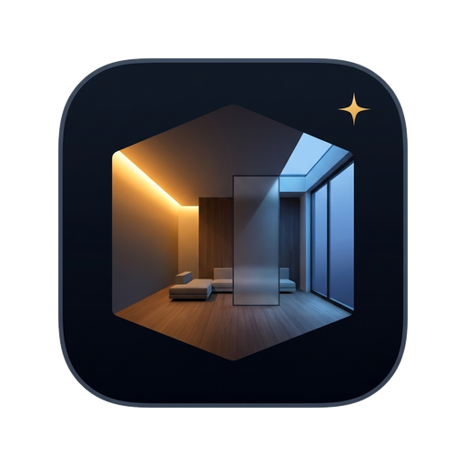
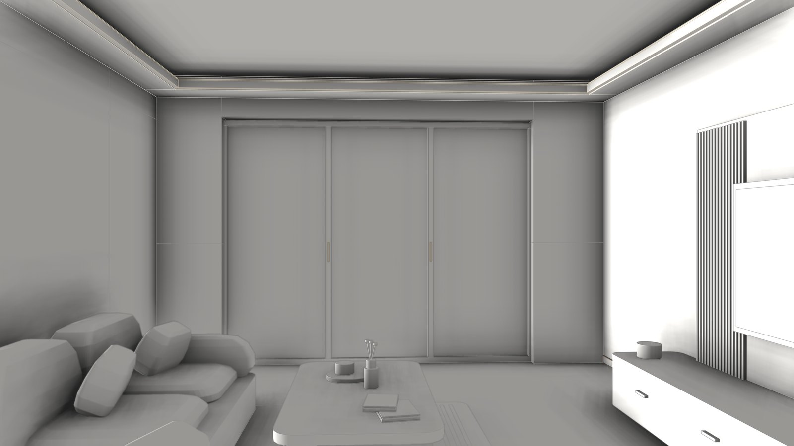
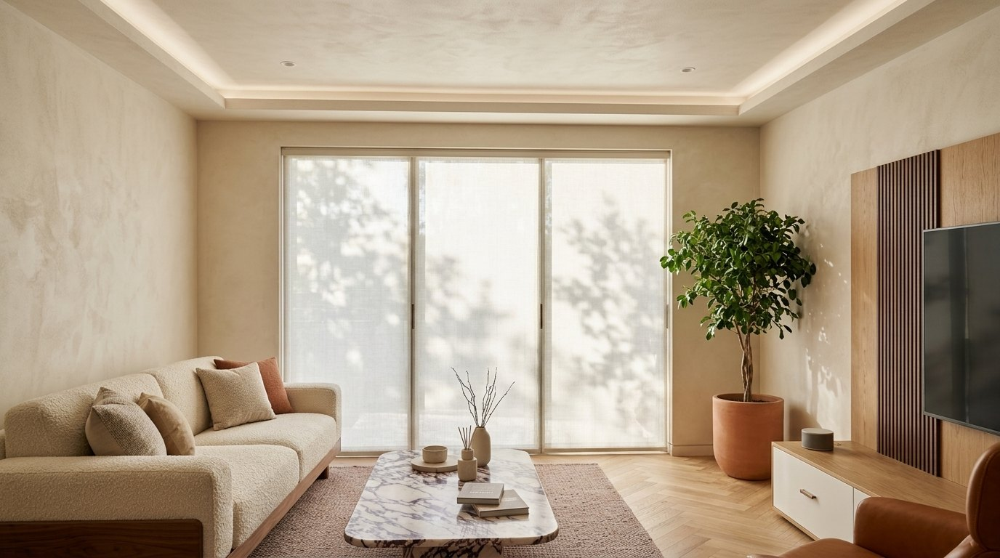
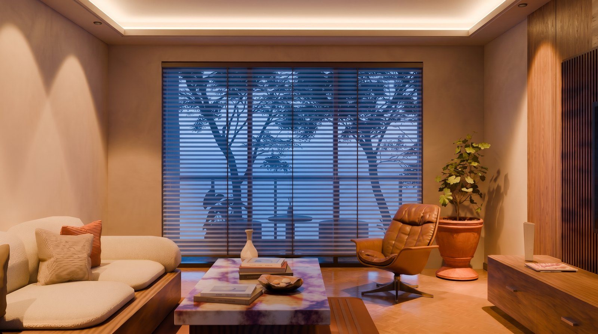
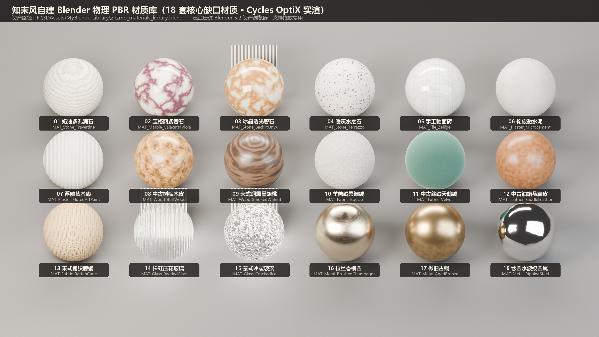
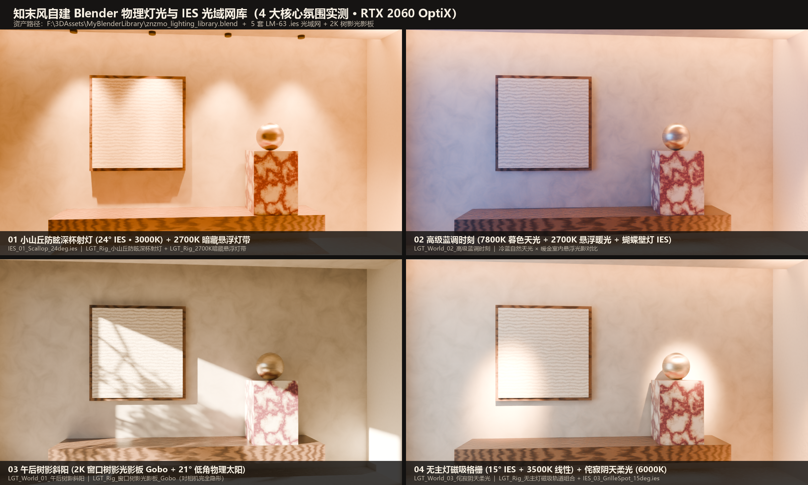

<div align="center">



# Archviz Studio

**The AI Interior & Architectural Visualization Engine for Antigravity**

*Turn CAD drawings, clay/white models (`白模`), and gray models (`灰模`) into Architectural Digest–grade 2K/4K photographs — with zero-tolerance layout lock, bundled PBR materials, and automated 1:1 native-pixel Self-QA.*

<p>
  <a href="README_ZH.md"></a>
  
  
  
  
  <a href="LICENSE"></a>
</p>

[English](README.md) · [简体中文 (小白保姆级教程)](README_ZH.md)

</div>

---

## ✨ Why Archviz Studio?

Most AI rendering tools look great at a glance — **until your client zooms in and notices the lounge chair vanished, the window mullions changed, or the wood cabinet turned into plastic stripes.**

**Archviz Studio** solves this by packaging an end-to-end production pipeline into a single plug-and-play **Antigravity Plugin**:

- **Pre-Render Spatial & Furniture Inventory + Zero-Tolerance CAD Veto (`AGENTS.md`)** — Drawings and models are law. Before rendering, the agent extracts an exact inventory of walls, ceiling coves, door/window panels, and every hero furniture item (trusting written CAD dimensions over pixel ratios); after rendering, it runs a side-by-side diff + object-by-object audit where any missing or relocated item triggers an automatic **NO-SHIP** rework.
- **Standardized `--look` Lighting Presets** — Switch the entire scene mood cleanly from the same camera using 5 standardized presets (`daylight`, `bluehour`, `golden_afternoon`, `overcast_soft`, `warm_night`).
- **Automated 1:1 Native-Pixel Macro Self-QA** — High-res renders (`>= 1920px`) are automatically sliced at 100% native pixels into 4–6 macro inspection crops (fabrics, tabletop props, chair contact, wood grain, ceiling coves) and red-team scored across 9 dimensions before handoff.
- **Layout-Locked Google Flow Rendering (`gflow-cli`)** — Drives Nano Banana 2.1 `i2i` + 2K/4K upscaling via MCP & CLI directly from your own Google Flow account.
- **Bundled Znzmo 18 PBR Material & 4 Architectural Lighting Library + Blender 5.x Craft Guardrails** — 19 MB ready-to-use Blender 5.x Asset Browser library (Travertine, Calacatta Viola Marble, Burl Wood, Bouclé, Microcement, Reeded Glass, 5 ANSI IES profiles, and dappled tree Gobos), plus `AgX` vs `Khronos PBR Neutral` color management, draft-first diff iteration (`960×540 / 32 samples`), and 8 GB GPU VRAM/motion-blur playbooks.
- **Optional Full CAD → 3D → AI Bridge** — One-click bootstrap for AutoCAD MCP, SketchUp MCP (port `9876`), and Blender MCP (port `9877`).

---

## 🖼️ Real Pipeline Showcase

> **All outputs below were generated directly by this plugin workflow — strictly preserving room geometry and furniture layout.**

| 1. Input Clay Model (`白模`) | 2. Daylight Interior (`gflow i2i`) | 3. Blue Hour 2K + 1:1 QA (`gflow upscale`) |
| :---: | :---: | :---: |
|  |  |  |
| *Exact CAD/SketchUp geometry baseline* | *Warm limewash, Calacatta Viola marble, dappled sunlight* | *7800K twilight vs. 2800K cove glow, 100% furniture locked* |

### Bundled Blender PBR Material & Lighting Library (`19 MB` included)

| 18 Procedural Architectural PBR Materials | 4 Architectural Lighting Presets + 5 IES + Tree Gobo |
| :---: | :---: |
|  |  |

---

## 📦 What's Inside the Plugin

```text
archviz-studio/
├── plugin.json                        # Native Antigravity plugin manifest
├── mcp_config.json                    # Auto-mounts archviz-gflow MCP (gflow mcp run)
├── rules/
│   └── AGENTS.md                      # Always-on Mandatory Self-QA Gate (CAD veto + 1:1 crop audit)
├── skills/
│   ├── archviz-bootstrap/SKILL.md     # One-click new-machine installer & troubleshooting runbook
│   ├── archviz-gflow/SKILL.md         # Layout-locked i2i, 2K/4K upscale & QA execution workflow
│   └── archviz-blender-craft/SKILL.md # Blender 5.x compatibility & PBR material craft guardrails
├── scripts/
│   ├── setup_archviz_env.ps1          # Automated Windows dependency & library installer
│   └── register_blender_asset_lib.py  # Headless Blender Asset Browser registration
└── assets/
    ├── logo.png                       # Transparent square plugin icon
    └── MyBlenderLibrary/              # 18 PBR materials, 4 lighting rigs, 5 IES, tree Gobo, book covers
```

---

## 🚀 3-Minute Quick Start (Windows 10/11)

### Prerequisites
- **Google Chrome** (official desktop install)
- A **Google account** with access to [Google Flow](https://flow.google.com) *(standard accounts support free image generation & **2K** upscaling; Ultra plans unlock **4K**)*
- **Antigravity** installed
- *(Optional)* AutoCAD, SketchUp, or Blender — **not required** if you only want to render from existing clay/white-model screenshots.

### Step 1 — Install the Plugin
Run this single command in PowerShell:

```powershell
git clone https://github.com/wqwin/archviz-studio.git "$env:USERPROFILE\.gemini\config\plugins\archviz-studio"
```

*(Prefer a ZIP? Download the release ZIP and extract the `archviz-studio` folder into `C:\Users\<YourName>\.gemini\config\plugins\`.)*

### Step 2 — Let Your AI Agent Bootstrap Everything
Open **Antigravity** (you'll see **Archviz Studio** under *Customizations → Installed → Plugins*) and send:

> **Initialize the archviz-studio plugin environment and check gflow-cli status.**

The agent will automatically install `uv`, `gflow-cli`, deploy and register the bundled 19 MB Blender material library, configure `gflow` global `.env` defaults, and optionally install AutoCAD / SketchUp / Blender MCPs.

### Step 3 — 2 One-Time Manual Browser Clicks
For account security and copyright compliance, you complete two one-time browser actions:
1. Run `gflow auth login` in PowerShell, sign in to Google Flow, and close the window.
2. Open Flow once using the isolated profile command provided by the agent, upload any test image, accept the one-time **"Rights to use this image"** dialog, and close Chrome.

After that, every `i2i` render, style switch, and 2K/4K upscale runs **100% unattended**.

---

## 💬 Starter Prompts

Drop your latest white/clay model (`白模`) or 3D viewport screenshot into Antigravity and try:

- **Daylight Editorial Render**:
  > Render this clay model in warm modern wabi-sabi daylight (cream limewash plaster, herringbone light oak floor, Calacatta Viola marble coffee table). Strictly preserve every piece of furniture and opening, upscale to 2K, and run the 1:1 pixel Self-QA.
- **Blue Hour Atmosphere**:
  > Keep 100% of the furniture and layout from this reference unchanged. Re-render in Blue Hour twilight (7800K deep blue dusk outside, 2800K continuous warm indirect cove lighting inside), upscale to 2K, and pass 1:1 Self-QA.
- **Material Swap Only**:
  > Lock the exact room layout and lounge chair position. Swap only the coffee table to mid-century burl wood veneer and the TV console to smoked walnut, then render at 2K with Self-QA.

---

## 📄 License

[MIT License](LICENSE) © 2026 [wqwin](https://github.com/wqwin).
Built on top of the open-source ecosystem including [`ffroliva/gflow-cli`](https://github.com/ffroliva/gflow-cli), [`arjun988/blender-skills`](https://github.com/arjun988/blender-skills), and [`ahujasid/mcp-for-blender`](https://github.com/ahujasid/mcp-for-blender).
