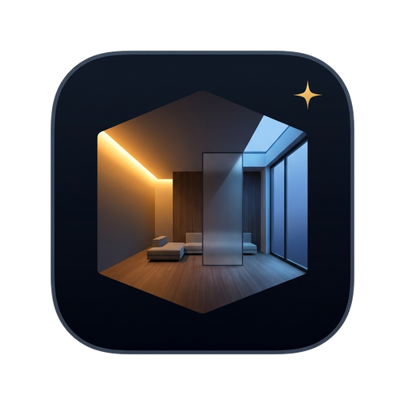
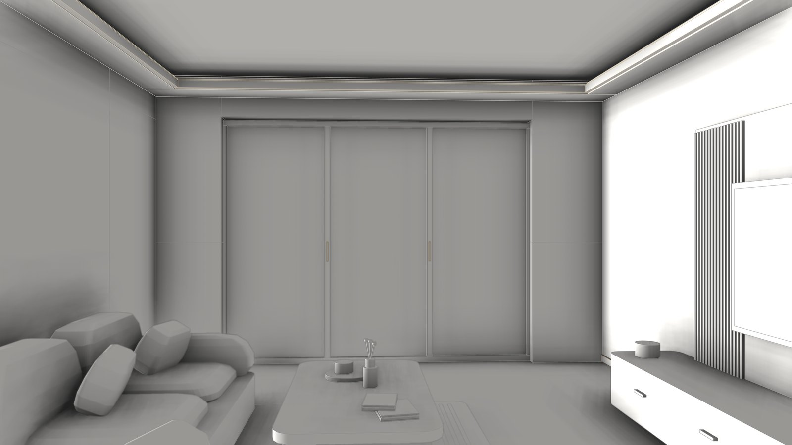
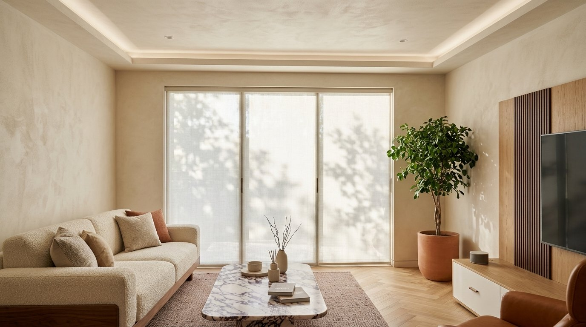
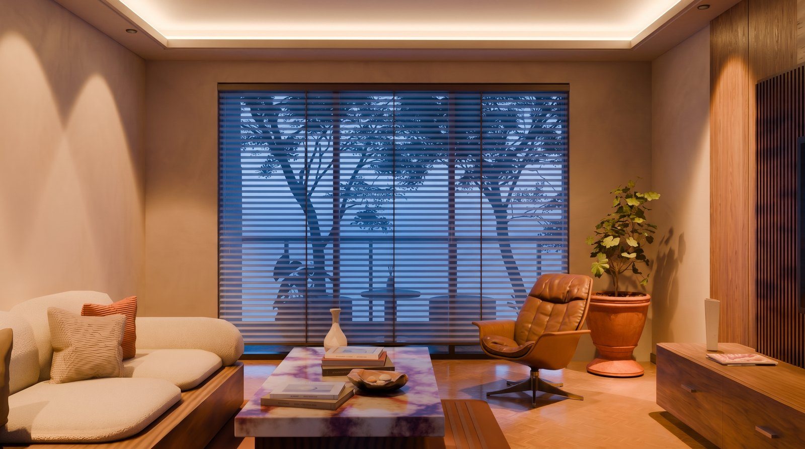
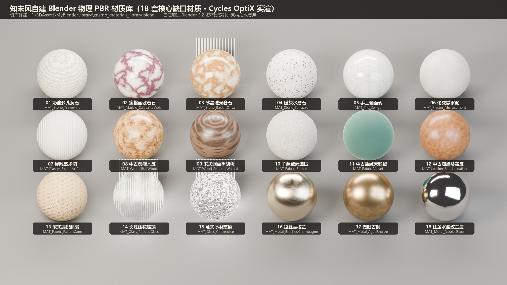
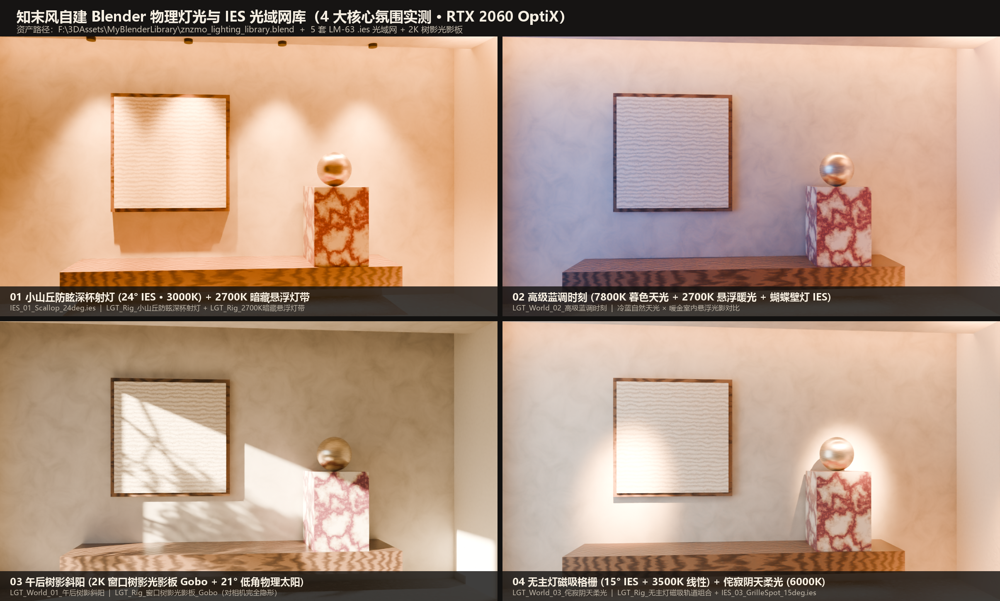

<div align="center">



# Archviz Studio

**面向 Antigravity 的室内与建筑 AI 效果图工作台**

*把 CAD 图纸、白模 / 灰模一键变成《安邸 AD》级 2K/4K 实景摄影效果图 —— 零容忍图纸锁形 · 内置 18 套知末风 PBR 材质库 · 1:1 原生像素自动质检*

<p>
  <a href="README.md"></a>
  
  
  
  
  <a href="LICENSE"></a>
</p>

[English](README.md) · [简体中文](README_ZH.md)

</div>

---

## ✨ 为什么做 Archviz Studio？

很多 AI 室内出图工具乍一看很漂亮，但一放大给甲方看就翻车：**单人椅凭空消失、门窗扇数变了、木柜台面长出塑料斑马纹、抱枕像瓦楞纸……**

**Archviz Studio** 把整套专业室内表现工作流封装成了一个开箱即用的 **Antigravity 原生插件**：

- **零容忍图纸/白模锁形（一票否决）**：内置全局强制质检规则（`rules/AGENTS.md`），每次交付前 AI 必须逐物清点墙体、吊顶灯槽、门窗扇数、沙发、单椅、茶几、绿植与柜体——**只要漏掉、多出或挪动任何一件家具，自动判 NO-SHIP 并返工重渲**。
- **1:1 原生像素微距自动质检**：凡是 `≥ 1920px` 的高清成图，AI 都会用 Pillow 按 100% 原生像素自动切出 4~6 组关键特写（沙发抱枕、茶几摆件、单椅落地、木皮柜体、吊顶灯槽），按 9 大维度红队打分，任何一项 `< 8/10` 自主精修后再交付。
- **基于 Google Flow (`gflow-cli`) 的锁形出图与 2K/4K 扩图**：调用 Nano Banana 2.1 `i2i` 垫图渲染，自动配置好防卡顿排队锁与项目复用。
- **内置 19 MB《知末风自建素材库》**：18 套建筑 PBR 材质（奶油洞石、宝格丽紫奢石、树瘤木皮、羊羔绒、微水泥、长虹玻璃、拉丝香槟金等）+ 4 套建筑灯光预设 + 5 个 IES 光域网 + 树影 Gobo，装有 Blender 时自动注册到资产浏览器。
- **可选打通 AutoCAD / SketchUp / Blender**：按需一键挂载三大专业软件 MCP（自动隔离端口避免冲突）。

---

## 🖼️ 真实出图效果展示

| 1. 输入：白模基准图（`白模`） | 2. 日景自然光出图（`gflow i2i`） | 3. 蓝调时刻 2K 精修 + 1:1 质检 |
| :---: | :---: | :---: |
|  |  |  |
| *严格对齐 CAD / SU 空间几何* | *奶油微水泥、宝格丽紫奢石、斑驳树影* | *室外 7800K 暮色 × 室内 2800K 暖光，家具 100% 锁定* |

### 内置 Blender 建筑 PBR 材质与灯光图鉴（已随插件打包）

| 18 套建筑 PBR 材质库 | 4 大建筑灯光预设 + 5 个 IES + 树影 Gobo |
| :---: | :---: |
|  |  |

---

## 🚀 3 分钟极简安装教程（面向非计算机专业用户）

### 零、开始前需要准备好的东西（预置条件）
1. **Windows 10 / 11 电脑**（能正常打开 `https://flow.google.com`）
2. **Google Chrome 浏览器**（官方版，https://www.google.com/chrome/）
3. **Google 账号**（能登录 Google Flow；普通账号支持免费生图与 **2K** 扩图，Ultra 订阅支持 **4K**）
4. **Antigravity 客户端**（已安装并登录）
5. *(可选)* AutoCAD、SketchUp、Blender —— **如果只是拿白模/灰模截图给 AI 出效果图，这三个软件完全不用装！**

### 第一步：安装插件到本机
打开 PowerShell，粘贴运行这一行命令（免登录 GitHub 直接拉取）：

```powershell
git clone https://github.com/wqwin/archviz-studio.git "$env:USERPROFILE\.gemini\config\plugins\archviz-studio"
```

*(或使用离线压缩包：将 `archviz-studio-v1.0.0.zip` 解压到 `C:\Users\<你的用户名>\.gemini\config\plugins\`，确保路径为 `...\plugins\archviz-studio\plugin.json`。)*

### 第二步：让 AI 自动装完所有底层工具
打开 **Antigravity**（在 `Customizations → Installed → Plugins` 里就能看到 **Archviz Studio**），直接发一句话：

> **帮我初始化 archviz-studio 插件环境并检查 gflow-cli 状态**

AI 会自动运行内置脚本，帮你装好 `uv`、`gflow-cli`、部署并注册 19 MB 知末风 Blender 材质灯光库、写好防卡顿 `.env` 配置，并按需安装 AutoCAD / SketchUp / Blender MCP。

### 第三步：必须由你本人手动点的 2 次鼠标（每台电脑只需做一次）
1. **登录 Google Flow 账号**：在 PowerShell 运行 `gflow auth login`，在弹出的 Chrome 里登录你的 Google 账号后关闭窗口。
2. **点一次上传版权确认框**：按 AI 给你的专属 Chrome 命令打开一次 Flow 项目页，随便上传一张图，点掉 **“Rights to use this image”** 确认弹窗，然后关闭该 Chrome 窗口。

完成后，以后所有“白模出效果图 / 换风格 / 2K~4K 扩图 / 1:1 质检”全部**全自动运行**！

---

## 💬 日常一句话出图模板

直接把你的 **最新完整白模/灰模图** 拖进 Antigravity 对话框：

- **日景自然光**：
  > 按这张白模图，用 `gflow-cli` 生成一张现代侘寂风日景自然光效果图（奶油微水泥、浅木人字拼、宝格丽紫奢石茶几），严格保留图里所有家具和位置，然后扩图到 2K 并按质检手册做 1:1 局部质检。
- **蓝调时刻**：
  > 保持这张图里所有家具和布局 100% 不变，用 `gflow-cli` 换成高级蓝调时刻（室外 7800K 暮色蓝、室内 2800K 暖光灯槽），扩图到 2K 并过 1:1 像素质检。
- **只换材质不动布局**：
  > 锁定这张图里所有家具、单椅和门窗位置，只把茶几换成中古树瘤木皮，电视柜换成烟熏黑胡桃木，用 `gflow-cli` 重新渲染并质检。

---

## 🛠️ 常见问题速查

| 现象 | 原因 | 解决办法 |
| :--- | :--- | :--- |
| 提示 `4K upscale requires a Flow Ultra subscription` | 当前账号不是 Ultra 订阅 | 正常现象，AI 会自动切换为 **2K** 扩图（`2752 × 1536`）。 |
| 提示 `MediaUploadRejectedError` | 尚未在专属窗口点掉首次上传版权确认 | 按第三步第 2 条打开专属窗口传图点同意后关闭窗口重试。 |
| 提示 `ProfileLockedError` | `gflow` 专属 Chrome 窗口还开着 | 关闭该 Chrome 窗口即可继续。 |

---

## 📄 开源协议

[MIT License](LICENSE) © 2026 [wqwin](https://github.com/wqwin)
